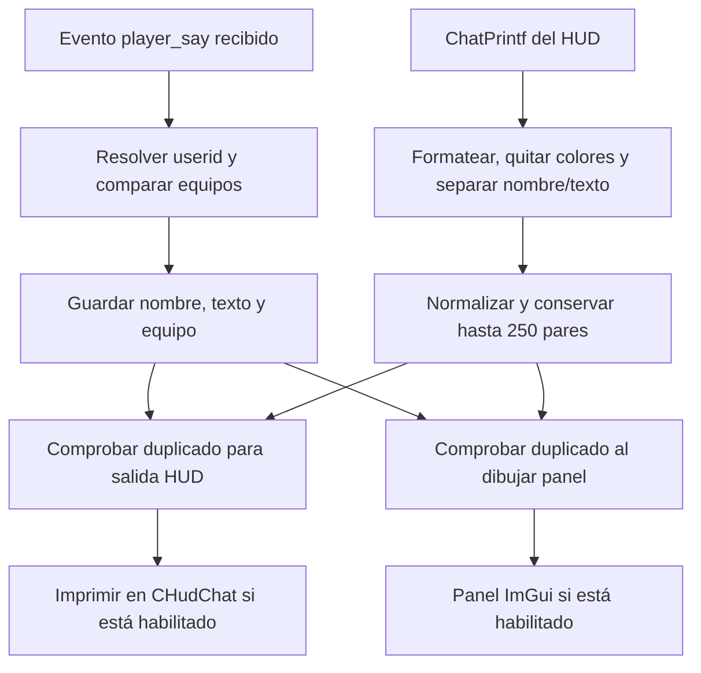

# Análisis del chat de Raze

La ruta descrita ya tiene una [implementación integrada en FREE](CHAT_SPY_IMPLEMENTATION.md), con reglas de duplicados y límites propios.

Raze obtiene el chat del otro equipo mediante eventos `player_say` recibidos por el cliente. Intercepta además `CBaseHudChat::ChatPrintf` para recordar mensajes que pasan por el HUD y evitar mostrarlos otra vez. Tiene dos salidas configurables: un panel ImGui y el chat del HUD.

Esta ruta depende de los eventos que recibe el cliente. El análisis no demuestra que pueda recuperar mensajes que el servidor no envíe. La opción encontrada se llama `Filter enemy chat` / `Filtrar chat enemigo`; las opciones `Spy-Hack` de cámara son otra función.

## Binario y método

| Dato | Valor |
| --- | --- |
| Original | `C:\Users\User\Desktop\raze\RZL4D2_[unknowncheats.me]_.dll` |
| Tamaño / arquitectura | 4.190.720 bytes / PE32 x86 |
| SHA-256 | `dfa8632e85c89c318577ef619f20bae2f4db5136042d680ee4dae4109234691a` |
| Base preferida | `0x10000000` |
| IDA instalado | Pro 9.4, versión `9.4.260714.951e98a4` |
| Herramienta | [mrexodia/ida-pro-mcp](https://github.com/mrexodia/ida-pro-mcp), paquete 2.0.0 |
| Commit instalado | `c133c3853faa111a9b00ee615c013b720d0c4acd` |
| Sesión MCP | `raze-chatspy`, supervisor en `http://127.0.0.1:8745/mcp` |

Se usó IDA/idalib con Hex-Rays sobre una copia independiente. Se verificaron los puntos principales con instrucciones x86 y referencias cruzadas. El binario original y su base abierta en IDA permanecen intactos. Los nombres `ChatSpy_*` son anotaciones del análisis, no símbolos originales. La DLL analizada no se ejecutó ni se inyectó.

## Flujo recuperado



### Registro y recepción

`0x1003F550` registra el listener para `player_say` con el último argumento de `AddListener` a cero, además de eventos de votación. Evita registrarlo dos veces mediante un indicador en `this + 8`. `0x1003F480` retira el listener.

`0x10040550` reconoce `player_say`, extrae `userid` mediante la llamada virtual a desplazamiento `+0x18`, lo convierte a índice con el motor (`+0x24`) y acepta índices de 1 a 64. Obtiene la entidad por `GetClientEntity` y resuelve `CBaseEntity::m_iTeamNum`.

La condición de selección es **equipo del emisor distinto del equipo local**. No exige explícitamente la pareja supervivientes/infectados. Obtiene el nombre mediante información del jugador y usa `Unknown` si está vacío. Extrae `text` mediante una llamada virtual a `+0x24` del evento y descarta texto vacío.

Se guarda el registro antes de comprobar las opciones de salida. Por tanto, apagar la casilla principal no impide por sí solo que esta función añada registros mientras el listener siga activo.

### Caché del HUD y duplicados

`0x10171B90` instala el hook de ChatPrintf: usa el destino resuelto en `0x103EC658`, el callback `0x10171BB0` y la dirección de almacenamiento del original `0x103F7514`. La etiqueta de la firma es `CBaseHudChat_ChatPrintf` y su módulo es `client.dll`.

El callback:

1. Formatea la llamada en un búfer de 2.048 bytes.
2. Elimina bytes de control de color `0x01` a `0x07`.
3. Busca la primera secuencia ASCII `" : "` y separa nombre y mensaje.
4. Vuelve a limpiar colores y llama a `0x1003EAB0` para conservar el par.
5. Continúa hacia la función original.

`0x1003ED00` aplica `tolower`, agrupa secuencias de espacios con `isspace` en un espacio y recorta los extremos. `0x1003EAB0` normaliza tanto el nombre como el texto y añade dos objetos de cadena de 24 bytes a una cola. Al alcanzar **251 entradas**, llama a `0x1003EF20` para retirar la más antigua: quedan como máximo **250**.

`0x1003F080` busca coincidencia de ambos campos normalizados. No compara userid, identificador de mensaje ni antigüedad. El resultado se consume como un booleano en `AL`, aunque el prototipo inferido inicialmente por Hex-Rays no lo reflejaba bien.

Evidencia x86 del límite:

```asm
1003EC36  mov eax, [ecx+48h]       ; cantidad de pares del HUD
1003EC39  inc eax
1003EC3A  mov [ecx+48h], eax
1003EC3D  cmp eax, 0FBh           ; 251
1003EC42  jb  short loc_1003EC4C
1003EC47  call ChatSpy_PopOldestHudMessage
```

### Salidas y limpieza

La salida al HUD exige la opción principal y la opción HUD, y que el par no esté en la caché. `0x10040410` localiza `CHudChat` y utiliza ChatPrintf. Puede añadir un prefijo de equipo localizado, o esconderlo mediante `0x103F5A78`. El valor de equipo 3 selecciona el prefijo de infectado; el otro camino usa superviviente.

`0x100421E0` exige la opción principal y la opción de panel. Recorre los registros con paso de 76 bytes y consulta de nuevo la caché de duplicados para cada entrada. El panel se llama `Filter Enemy Chat`, contiene `ChatScrollRegion` y ajusta el desplazamiento cuando cambia la cantidad visible.

El panel también contiene la limpieza manual y la limpieza periódica. La configuración permite modo `None`/`Timed` y un intervalo en minutos; el cálculo observado multiplica el intervalo por 60. Estas limpiezas vacían tanto los registros de eventos como la caché del HUD. Como están detrás de las condiciones del panel, no deben interpretarse como un temporizador independiente siempre activo.

### Estructuras recuperadas

| Desplazamiento en el registro de evento | Contenido observado |
| --- | --- |
| `+0x00` | Nombre, objeto de cadena de 24 bytes |
| `+0x18` | Copia tratada como cadena de unidades de 16 bits, 24 bytes |
| `+0x30` | Texto en bytes usado por las salidas y el comparador, 24 bytes |
| `+0x48` | Equipo, entero de 4 bytes |
| Total | **76 bytes**, guardados en un vector que comienza en `listener + 0x18` |

La cola de pares normales comienza en `listener + 0x38`; cada par contiene dos cadenas y ocupa 48 bytes.

Hay una ambigüedad de tipos relevante: Hex-Rays muestra `wchar_t*` y una copia mediante `wcslen`, pero `0x1003E910` reconstruye el texto copiando el byte bajo y después el alto de cada palabra, deteniéndose en el primer byte cero. Esto es compatible con reconstruir un búfer de bytes terminado en NUL. No demuestra que `text` sea UTF-16 ni que exista una conversión Unicode; no se renombró la llamada virtual a un supuesto `GetWString`.

## Mapa de funciones y configuración

Las VA corresponden a esta imagen; para una carga en otra base, usar `base real + RVA`.

| VA | RVA | Nombre asignado / función |
| --- | --- | --- |
| `0x1003F550` | `0x0003F550` | `ChatSpy_RegisterEvents` |
| `0x1003F480` | `0x0003F480` | `ChatSpy_UnregisterEvents` |
| `0x10040550` | `0x00040550` | `ChatSpy_OnGameEvent` |
| `0x1003F660` | `0x0003F660` | `ChatSpy_GetPlayerName` |
| `0x10171B90` | `0x00171B90` | `ChatSpy_InstallChatPrintfHook` |
| `0x10171BB0` | `0x00171BB0` | `ChatSpy_HookChatPrintf` |
| `0x1003EAB0` | `0x0003EAB0` | `ChatSpy_RememberHudMessage` |
| `0x1003ED00` | `0x0003ED00` | `ChatSpy_NormalizeText` |
| `0x1003EF20` | `0x0003EF20` | `ChatSpy_PopOldestHudMessage` |
| `0x1003F080` | `0x0003F080` | `ChatSpy_HasMatchingHudMessage` |
| `0x10040410` | `0x00040410` | `ChatSpy_PrintToHud` |
| `0x10040F80` | `0x00040F80` | `ChatSpy_AppendEnemyRecord` |
| `0x10041040` | `0x00041040` | `ChatSpy_DestroyEnemyRecord` |
| `0x100421E0` | `0x000421E0` | `ChatSpy_DrawPanelAndClearHistory` |
| `0x100F2FC0` | `0x000F2FC0` | `ChatSpy_DrawSettings` |
| `0x1003E910` | `0x0003E910` | `ChatSpy_PackWideCodeUnits` |

| VA | Significado |
| --- | --- |
| `0x103F5A74` | Activación principal, clave persistida `bPlayerEnemyChat` |
| `0x103F5A75` | Salida ImGui, `bShowEnemyChatIn[0]` |
| `0x103F5A76` | Salida HUD, `bShowEnemyChatIn[1]` |
| `0x103F5A78` | Ocultar prefijo de equipo en HUD |
| `0x103F5AA0` | Modo de limpieza |
| `0x103F5AA4` | Intervalo de limpieza en minutos |
| `0x103EF14C` | Solicitud de limpieza manual |
| `0x103F7514` | Original/trampolín de ChatPrintf |

## Consecuencias y límites de lo demostrado

- La supresión de duplicados puede ocultar una repetición legítima del mismo nombre y texto mientras el par siga entre los 250 mensajes del HUD. También puede confundir jugadores con el mismo nombre.
- La separación por el primer `" : "` depende del formato del HUD. Un prefijo o un nombre con ese separador puede impedir que coincida con el nombre obtenido del evento.
- El panel vuelve a filtrar contra una caché que cambia: la visibilidad de un registro puede cambiar después de recibirlo. No es una lista inmutable de todos los eventos.
- La comparación de equipos incluye cualquier equipo distinto. No permite concluir que cada registro corresponda a un mensaje privado de equipo: no se observó una comprobación de `teamonly` en esta ruta.
- El límite de 250 corresponde a la cola del HUD. No se encontró un límite equivalente en la función que añade registros al vector de eventos; las limpiezas examinadas están en el panel. No se auditó exhaustivamente toda la vida del objeto.
- Son resultados de análisis estático. No se probó la recepción real de chat del otro equipo en una partida local ni en un servidor remoto. Tampoco se verificaron experimentalmente el orden de callbacks y la interacción entre las dos salidas.

Se encontró también una firma llamada `CUserMessages_DispatchUserMessage`, pero su presencia no demuestra que sea el mecanismo de esta función. La ruta de `player_say` y el hook del HUD sí quedaron conectados mediante referencias y llamadas.

## Archivos y uso del MCP

- [Desensamblado completo de las diez funciones principales](re/raze/CHAT_SPY_DISASSEMBLY.asm): 2.308 instrucciones exportadas por MCP, con nombres anotados.
- [Evento principal decompilado](re/raze/0x10040550-decompile.json), [hook del HUD](re/raze/0x10171bb0-decompile.json), [caché](re/raze/0x1003eab0-decompile.json) y [comparador](re/raze/0x1003f080-decompile.json).
- [Instrucciones del flujo de guardado y salida](re/raze/event-route-asm.json), [límite de caché](re/raze/key-asm.json) y [terminación por byte NUL](re/raze/packing-asm.json).
- [Base anotada de IDA](C:/Users/User/.codex/tools/ida-analysis/raze/raze-chatspy-annotated.i64), guardada fuera del proyecto: 16 funciones y 8 variables renombradas, con comentarios explicativos.

El servidor está instalado en un entorno Python dedicado y registrado en Codex como `ida_pro_mcp`, transporte HTTP local. Se utiliza el supervisor idalib del repositorio; no se modificó el plugin de la ventana de IDA que ya estaba abierta. El supervisor usa el IDA Pro 9.4 instalado. La sesión de trabajo puede caducar por inactividad; la base anotada está guardada en disco.

Para volver a iniciar el servidor:

```powershell
.\tools\start_ida_mcp.ps1
```

Para consultar las sesiones mediante el mismo MCP:

```powershell
& "$env:USERPROFILE\.codex\tools\ida-pro-mcp-venv\Scripts\python.exe" `
  .\tools\ida_mcp_client.py idb_list '{}'
```

## Cambio de velocidad de esta entrega

El multiplicador configurable pasó a **1–15x** y comparte el límite entre menú, validación y presupuesto de comandos. El máximo añade 14 comandos a la llamada normal. Se conserva la fracción para valores como 14,5x y el presupuesto compartido con rapidfire.

La DLL Release Win32 compiló. Pasaron 88 comprobaciones: 16 de aim, 45 del runtime, 8 de persistencia y 19 del presupuesto de movimiento. El máximo configurado no garantiza una velocidad efectiva de 15x: falta probar cuánto acepta el servidor durante una partida.
