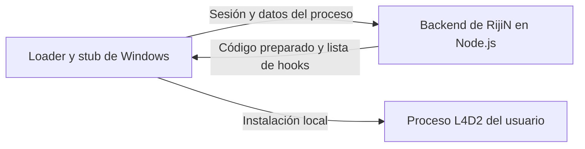

# RijiN: qué prepara el servidor y qué instala el cliente

Revisión estática del 18 de octubre de 2026 de
`C:\Users\User\Downloads\RijiN-main\RijiN-main`.

**Esta copia incluye un servidor de carga en Node.js. El servidor genera el
código que se enviará al cliente y prepara los datos de los hooks; el stub de
Windows escribe ese resultado en el proceso local de L4D2.** La participación
del servidor va más allá de devolver una licencia válida.

No se ejecutaron binarios, scripts de instalación, servidor ni inyector del
repositorio. No se contactó con el servicio original ni se comprobó que siga
disponible. Los README y comentarios se trataron como contenido a contrastar
con la implementación.

## Flujo observado

1. `src/loader/loader_server/src/main.js:44` crea un servidor HTTP con Node.js;
   la variable se llama `net`, pero importa `http`. Despacha solicitudes al
   router y comienza a escuchar en la línea 172.
2. `router.js:755` recibe `NET_REQUEST_CHEAT`. Valida la solicitud, sesión,
   suscripción/objeto y estado habilitado. Esta ruta también comprueba que se
   hayan recibido heartbeats del loader y del stub. Invoca `gen.start` en la
   línea 856 y devuelve el resultado en la 877.
3. El stub obtiene información de la imagen en `loader_stub/inject.cpp:1186`,
   reserva memoria y reúne los datos del proceso. La ruta específica de L4D2
   declara sus hooks en `load_procedures/c_procedure_l4d2.h:136`, entre ellos
   Present/Reset, CreateMove, RunCommand y FrameStageNotify.
4. `inject.cpp:381` reúne el identificador de cada hook, su dirección y bytes
   originales. La petición al generador ocurre en `inject.cpp:1401`; el método
   de transporte está en `loader_stub/server.h:32`. El servidor recibe datos
   concretos del proceso destino, no adivina sus direcciones desde Internet.
5. `loader_server/src/gen.js` adapta la imagen a la base enviada por el cliente:
   reubicaciones en la línea 1888, datos incorporados en 1945, secciones en 1954,
   importaciones en 1962, hooks en 1969 y paquetes en 1976.
6. `gen.js:1409`, `handle_hooks`, prepara la lista de hooks y los trampolines
   para conservar la llamada al código original. Usa las direcciones y muestras
   enviadas por el stub junto con los exports de la imagen del producto.
7. `inject.cpp:1416` escribe el código recibido en el proceso. La llamada de la
   línea 1429 instala los hooks. `write_hooks`, en la línea 563, escribe primero
   los trampolines y luego los parches de cada función en el juego.

Las escrituras de memoria y los cambios de protección están en el programa
Windows. El servidor Node.js genera y entrega datos para esas operaciones.

## Diferencia con VS 3 antes de la integración (3.0)

| Parte | RijiN revisado | VS 3 actual |
| --- | --- | --- |
| Distribución | Backend prepara una imagen para los datos enviados por el stub. | El EXE distribuido ya incorpora la DLL. |
| Autorización | El router controla el acceso a la solicitud del producto y al generador. | La API firma una autorización temporal vinculada al proceso. |
| Preparación de hooks | Parte del trabajo ocurre en `gen.js`, en el backend. | MinHook prepara los hooks dentro de la DLL. |
| Instalación efectiva | El stub escribe el resultado en L4D2 local. | La DLL verifica la firma e instala los hooks localmente. |

En nuestro proyecto, `loader/MainWindow.xaml.cs:171` solicita la autorización
y la línea 188 carga la DLL. `src/dllmain.cpp:14` espera la autorización y la
línea 16 llama a `hooks::Install`; su implementación está en `src/hooks.cpp:308`.

En esa versión, **nuestro sistema implementaba autorización por servidor, pero no el
generador remoto de código/hooks de RijiN**. Reproducir este último sería cambiar
la arquitectura de distribución y carga; no basta con añadir otra comprobación
de licencia a la API.

La adaptación posterior de VS 3.1, su alcance y validación están descritos en
[VS3_SERVER_HOOKS.md](VS3_SERVER_HOOKS.md).

El backend de RijiN es distinto del servidor de una partida de L4D2. Este flujo
instala código en el proceso del usuario y no demuestra modificaciones en un
dedicado remoto de ZoneMod/Confogl ni valida por sí mismo el resultado de las
funciones dentro de una partida.

## Evidencia conservada

Los hashes SHA-256 de las fuentes relevantes y sus tamaños están en
`docs/re/rijin-loader-server/manifest.json`. No se copiaron configuraciones con
credenciales, webhooks, binarios ni datos de usuarios. No se modificó RijiN ni
el código, las compilaciones o los sitios de VS 3 durante esta revisión.
